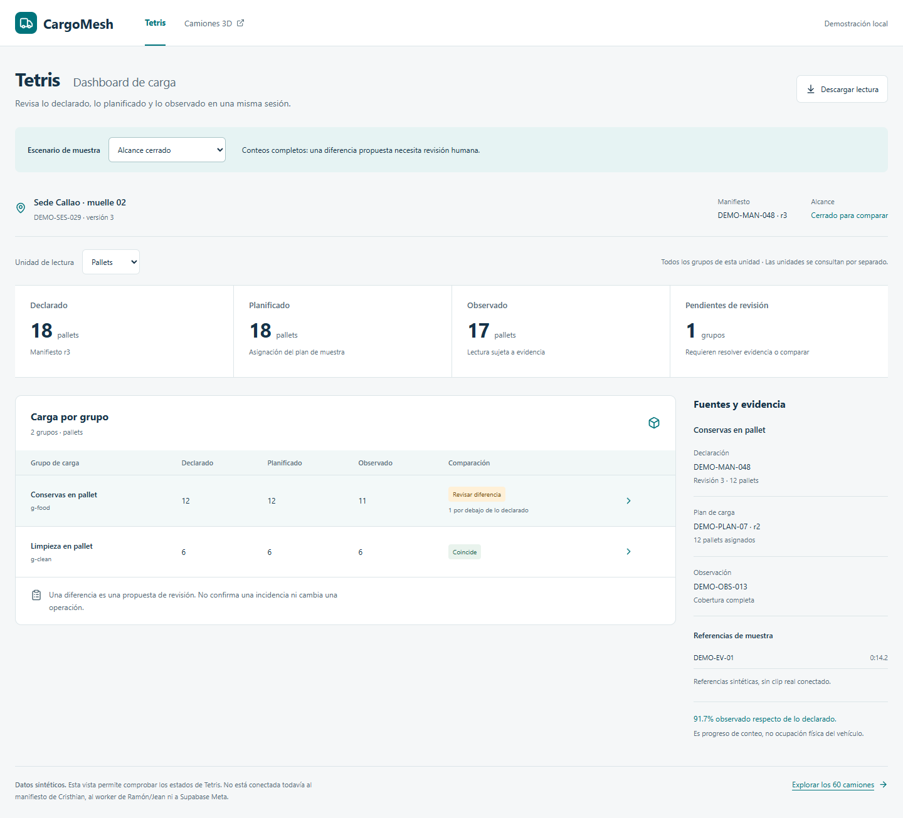
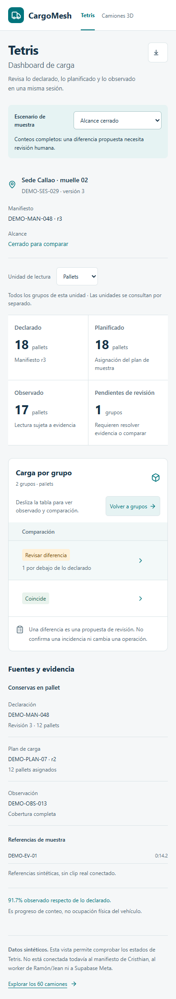
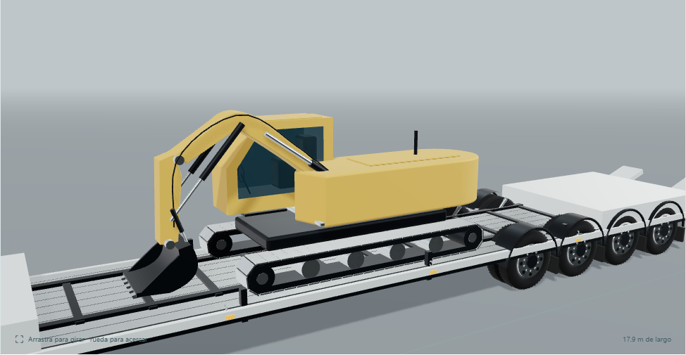
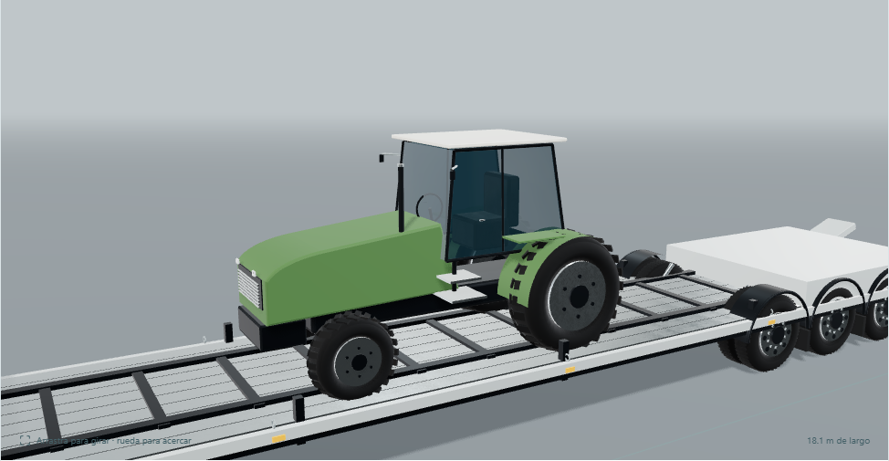
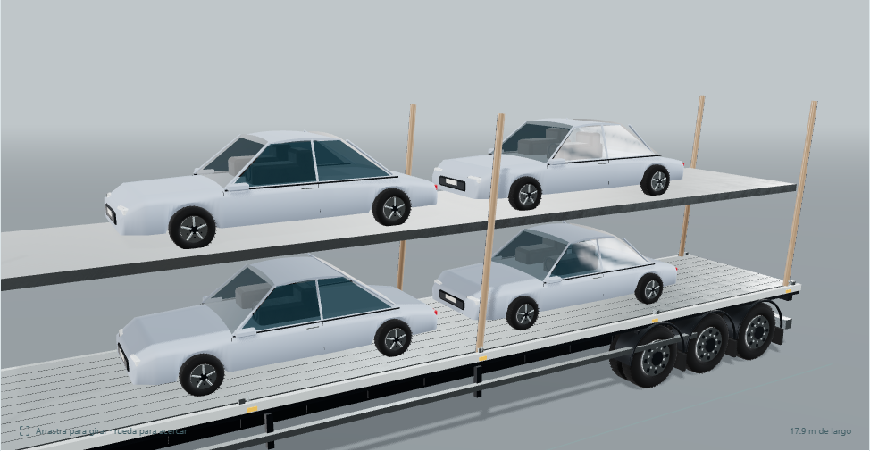

# Tetris y camiones — evidencia de Juan

29 de octubre de 2026. Código `c7730c3a40339a69b88927206e15fff0e4c77710`, rama `codex/meta-juan`, [PR #5](https://github.com/Chujutak2024/meta-hackathon/pull/5). Implementación asistida con Codex. Todas las capturas muestran datos sintéticos; no son inferencia de vídeo, flota real o una operación autorizada.

## Alcance obligatorio de Tetris

Dashboard operativo de carga con sesión/sede, declarado, planificado, observado y grupos pendientes de revisión; lectura separada de pallets/cajas, tabla y fuentes por grupo, cinco escenarios y descarga JSON. La sesión abierta conserva progreso. Una diferencia solo se propone con revisión/unidad/alcance y evidencia suficientes.

[`/tetris`](http://localhost:3000/tetris) es una demostración explícita, independiente del motor 3D. Schema y cálculo compartidos, reader con actor/repositorio inyectados y 21 pruebas propias. Contrato propuesto en [JUAN_DASHBOARD_READ_MODEL](../../contracts/JUAN_DASHBOARD_READ_MODEL.md); acuerdo con productores y conexión a Supabase Meta pendientes. No hay endpoint nuevo, persistencia, jobs, comandos de sesión, revisión humana o Passport.

## Galería solicitada por el usuario

[`/truck-lab`](http://localhost:3000/truck-lab): 60 diseños originales, 20 pequeños/20 medianos/20 grandes; datos/conductores ficticios. Cabinas curvas, cristales tintados, ruedas duales/neumáticos torneados y materiales PBR/HDR locales CC0. Se reconstruyeron cargas de automóvil, excavadora y tractor tras rechazo visual y revisión independiente; Detalle de carga permite examinarlas. Exportación completa GLB en metros.

Colección completa: [20 pequeños](pequenos-20.png), [20 medianos](medianos-20.png), [20 grandes](grandes-20.png). Los 60 GLB de muestra se exportan con `node --import tsx scripts/export-truck-collection.mjs <directorio>` desde `cargomesh/`; los binarios grandes no se versionan. Los mapas/licencia están en `cargomesh/public/truck-materials/`.

## Verificación del código

| Comando/comprobación | Resultado |
|---|---|
| `pnpm test:meta-loading` | 21/21 |
| `pnpm test:logistics` | 161/161, incluidas 9 de catálogo/carga |
| `pnpm test:carrier-operations` | 54/54; servicios operativos sin cambios tras la reconstrucción |
| `pnpm typecheck` | aprobado |
| `pnpm check:architecture` | 787 módulos/239 entradas cliente |
| `pnpm build` | aprobado tras la reconstrucción |
| Chrome 156, 1440/390px | 60 modelos PBR/HDR, controles/descarga; Tetris cinco escenarios, unidades/fuentes/JSON; sin errores de página o desbordamiento |
| Comparación móvil | 5/5 escenarios con columnas derechas alcanzables mediante Ver comparación/Volver a grupos |
| GLB/Blender 5.2.3 LTS | 60 exportados/importados, imágenes/buffers embebidos, sin imágenes externas sin empacar |
| Geometría | máximo 172.916 triángulos/17 mallas; todos distintos/finitos; envolvente de cargas visible comprobada |

La primera revisión fresca solicitó reconstrucción de maquinaria/automóviles e indicación de scroll móvil. La revisión completa posterior devolvió `ship` para las capturas y el alcance sintético; no sustituye aceptación de Cristhian/usuario, contratos acordados o revisión/merge del equipo. Las capturas tienen procedencia incrustada. Una prueba histórica o un render no acredita integración real.

El acomodo físico sigue opcional: capacidad por vehículo/grupo JU-05, 2D JU-06, 3D/arrastre JU-08/JU-09 y optimización JU-10. Estos modelos no prueban capacidad homologada, reparto por eje, estabilidad o seguridad de estiba. No se declara fotorealismo ni réplica exacta OEM.

## Sincronización con el equipo

El merge `4497e74` incorpora `main@a5c2a4d` con el incremento de Axel. Conserva exactamente las superficies/cálculos de Juan de `c7730c3`. Tras combinar los índices documentales, se repitieron las21 pruebas de Tetris y las37 pruebas Meta AI, tipos, arquitectura (796 módulos/239 entradas cliente) y build: aprobados. Ambas páginas devolvieron HTTP200. La CI conserva los checks de Axel y añade las suites de Juan; sus resultados remotos no estaban disponibles al consultar el PR.
