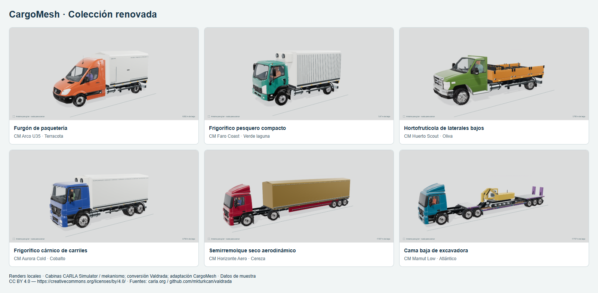

# Juan — colección local con cabinas detalladas

Sesión iniciada el 30 y cerrada el 31 de octubre de 2026 (America/Lima). Base `3810a589f75e4d4b9c7b7a7f2797cecffc791209`, rama `codex/meta-juan`. **Cambios sin commit, push o creación/actualización de PR, por instrucción expresa del usuario.**

## Resultado

`http://localhost:3000/truck-lab` muestra las 60 configuraciones con la técnica del prototipo: mallas de cabina elaboradas y licenciadas, materiales sobre UV, ruedas derivadas de las fuentes y ensamblaje con las carrocerías y cargas de muestra existentes. Conserva 20 pequeños, 20 medianos y 20 grandes, sus identidades, nombres, colores, conductores y unidades de carga. La carrocería recibe color propio; el acomodo sigue en metros. No se escribieron registros de flota u operación.

Se usan **cinco bases de cabina**, no 60 modelos OEM independientes: Sprinter, cabina con capó, Isuzu y Actros de techo alto/bajo. CARLA Simulator y mekanismo son autores de las mallas; Valdrada/M. K. Turkcan realizó sus conversiones anteriores. CargoMesh/Juan realizó cortes, atlas, LOD, ensamblaje y adaptación. [Licencias, fuentes, cambios y hashes](../../../../cargomesh/public/truck-cabs/LICENSE.md). Se descartó una base Volvo antigua cuyo aspecto seguía siendo básico.

La prueba estructural compara los 60 vehículos sin carga ni geometría del conductor y sin usar colores: las 60 estructuras son distintas. No significa que cada cabina sea de una familia diferente. Los datos siguen siendo ficticios y no acreditan capacidad homologada.

## Modelado y mejoras gráficas

- Se descodificaron localmente las fuentes Meshopt/KTX2. Cortes de plano reales evitan conservar triángulos largos invadiendo la caja; se retiraron restos de equipo médico/sirenas. Se cerraron paneles traseros donde correspondía.
- Cabina y ruedas tienen presupuestos separados de geometría. Las normales se transfieren desde la malla original después de reducirla. Los atlas tienen bordes de protección; color JPEG, normales y metal/rugosidad PNG. Los límites compartidos del importador permanecen en 200k triángulos, 16 imágenes y 12MiB.
- La escala de la cabina es proporcional; las ruedas copiadas conservan orientación y escala mundiales. `driveAxles` queda explícito y conserva la configuración previa, en lugar de inferirla del capó. Las camas bajas reservan longitud y altura según las ruedas reales del conjunto. Un defecto de pose dejaba los dedos exteriores de los pies en reposo: la máscara ahora cubre el ancho medido de la fuente y tiene regresión específica.
- El visor y el prototipo usan GTAO para sombras de contacto, MSAA para bordes y el HDR existente. Three.js ya instalado aporta los pases; no se añadió una dependencia o servicio de pago. Se conserva render bajo demanda.
- Visor y script usan un exportador común. Si el PNG generado por el navegador excede 12MiB, la descarga ajusta sus texturas a 1024px sin modificar la geometría; siempre pasa el inspector antes de descargarse. La resolución del visor no se reduce por esta adaptación.

## Evidencia de esta versión

- `pnpm test:logistics`: **173/173**. Incluye las cinco bases, hashes/atribución, encaje, orientación de ruedas y 60 estructuras diferentes sin recurrir al conductor, la carga o el color.
- `pnpm test:carrier-operations`: **54/54**. TypeScript y build de producción correctos; arquitectura **836 módulos / 243 entradas cliente**. Avisos heredados Three CJS/Clock, sin atribuirles un fallo funcional.
- Chrome: **60 modelos**, 20 vistas de detalle, tres descargas (pequeño/mediano/grande), comparación neutral y tres muestras a 390px sin desbordamiento. Cero errores de página, HTTP o peticiones fallidas. Error 503 explícito, descarga deshabilitada y recuperación verificados aparte. `browser.json` conserva el resultado final.
- **60 GLB finales**: 315.469.732 bytes en total. Máximo 9.700.168 bytes por archivo Node, 177.867 triángulos únicos, **186.155 triángulos instanciados**, 42 primitivas instanciadas y 15 imágenes. `export-verification.json` incluye hashes por archivo.
- Las descargas Chrome tuvieron 7.473.020, 9.036.480 y 11.167.996 bytes, y pasaron el mismo inspector. Se detectó y corrigió el caso previo de Chrome que producía 14,8MB, aunque el encoder Node cabía dentro del límite.
- **Blender 5.2.3 LTS** reimportó los 60 archivos finales: geometría finita, dimensiones métricas, conductor presente y **0 imágenes externas**. `blender-verification.json` contiene resultados por vehículo.

[20 pequeños](small.png) · [20 medianos](medium.png) · [20 grandes](large.png). Son capturas reales del visor, compuestas en una lámina HTML sin retoque generativo. Los GLB completos se mantienen en el directorio local de artefactos, fuera del árbol de la aplicación. `public/truck-cabs/` contiene únicamente las cinco bases reutilizadas, no 60 copias completas.

## Límites

Se replica el enfoque del prototipo y se amplía al conjunto; no se declara fotorrealismo ni una réplica exacta certificada de cada fabricante. Las cargas y carrocerías continúan siendo modelado propio de muestra. Pintura, ópticas, metal y anatomía admiten más trabajo. La aceptación estética corresponde al usuario.

Móvil comprobado por viewport de Chrome: no se midió rendimiento o memoria en dispositivos físicos. No se repitió el flujo operativo completo de sesiones/Tetris/Passport, ni se desplegó, migró o publicó nada. Este incremento permanece local.
