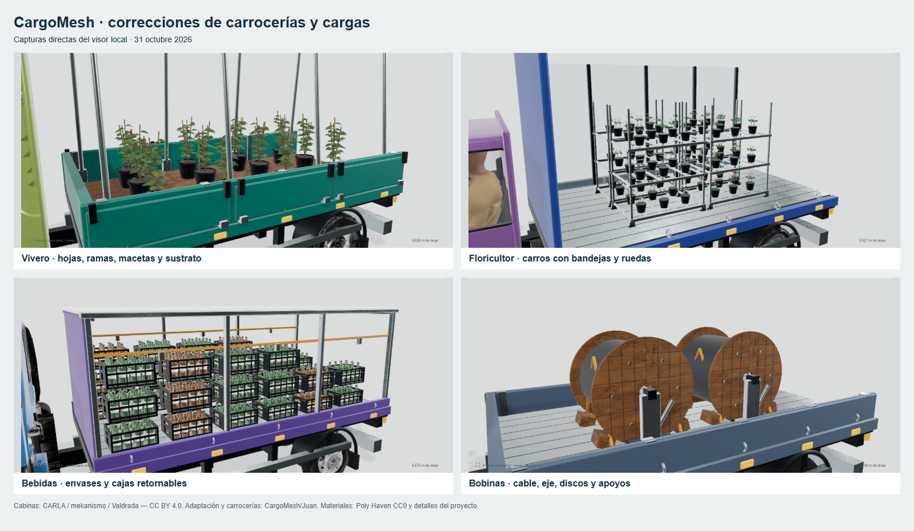

# Juan — correcciones locales de carrocerías y cargas, v8

31 de octubre de 2026. Working tree de `codex/meta-juan` sobre `3810a589f75e4d4b9c7b7a7f2797cecffc791209`. El usuario rechazó el acabado de v7 con ocho capturas. Esta iteración corrige esos casos; las pruebas técnicas no representan aprobación estética del usuario.

Abrir [galería local](http://localhost:3000/truck-lab#cm-nursery-bed). Sin commit, push, creación/actualización de PR, despliegue ni servicios nuevos. Sin dependencias o recursos de pago nuevos.

## Cambios visibles

| Captura / vehículo | Corrección |
| --- | --- |
| Puertas traseras / `cm-urban-curtain` y otras cajas | Portal según el perfil del techo, juntas, cierre central, bisagras y barras. Se elimina la abertura sobre las hojas. |
| Floricultor / `cm-florist-glass` | Los cuatro bloques se sustituyen por carros con ruedas, tres bandejas, macetas, tallos, hojas y flores. |
| Hortofrutícola / `cm-orchard-dropside` | Fruta de tamaño menor, capas, variación de color y superficie curva; mayor resolución en la fruta expuesta. |
| Bebidas / `cm-beverage-rack` | Cajas plásticas nervadas con asas, botellas con hombro, cuello, tapa y etiqueta; carga apilada en compartimentos de reparto. También afecta a retornables. |
| Cristalero / `cm-glass-stand` | Caballete específico, paquetes inclinados, cantos, separadores, correas y apoyos de goma. El panelero usa apoyos que alcanzan los seis paquetes. |
| Cable / `cm-cable-service` | Dos bobinas en tándem, discos de madera con orificio y pernos, cable con ranuras de enrollado, ejes apoyados y calzos; laterales bajos. |
| Volquete / `cm-landscape-tipper` | Caja pequeña de chapa vertical, bordones, bisagras, cierres, pivotes y subchasis; el árido se ajusta a esa sección. |
| Vivero / `cm-nursery-bed` | Macetas con borde, suelo, ramificación y hojas curvas de distintos tamaños/tonos. Se distribuyen los doce macetones y se conectan los arcos del bastidor. |

Se mantienen las 60 identidades de muestra, cantidades declaradas, medidas, masas y conductores. Cambian geometría, embalaje y colocación dentro de sus envolventes métricas. El vidrio de mercancía tiene su material propio, separado del acristalamiento de la cabina. Las cabinas siguen siendo las cinco bases licenciadas de v7; su autoría y licencia están en [truck-cabs/LICENSE.md](../../../../cargomesh/public/truck-cabs/LICENSE.md).

## Referencias constructivas

- [HEGLA: apoyos acolchados, bastidores y sujeción del vidrio](https://www.glastransportaufbauten.de/en/news/news-hegla-fahrzeugbau/safe-transport-and-more-flexibility-with-interior-conversion/).
- [GlassRack / bott: soportes y barras de retención](https://www.bott.si/documents/bott/katalogi/primedesign/111037_GlassRack_EN_HR.pdf).
- [Mercedes-Benz / MEILLER: caja basculante pequeña, laterales, subchasis y herrajes](https://conversion-world.mercedes-benz.com/en/GLOBAL/partner-produkt/9135/sprinter).

Son referencias de construcción; estas geometrías son adaptaciones del proyecto, no reproducciones CAD homologadas de esos fabricantes.

## Evidencia

- Build de producción final, incluyendo tipos/lint: correcto. `git diff --check`: correcto.
- Suite logística: **180/180**. Tras los últimos ajustes geométricos: **9/9** pruebas de envolventes y **2/2** regresiones de cierre/apoyo. El segundo test de apoyo es posterior a la ejecución de la suite completa; no se anuncia como una suite completa de 181.
- Navegador: recorrido de **60 vehículos**, seguido de revisión final de **9 configuraciones / 9 detalles**, cinco descargas GLB validadas y muestra a 390 px; sin errores JavaScript. El estado de inspección se cerró explícitamente antes de las capturas exteriores. Informes: [recorrido 60](browser-60.json), [revisión final](browser-final.json).
- Exportación final de **60 GLB**: 319.051.024 bytes en total; máximo 9.761.648 bytes, 182.475 triángulos únicos, **190.475 triángulos instanciados**, 42 primitivas instanciadas y 15 imágenes. Se conserva la validación del importador, sin ampliar sus límites. [Métricas por archivo](export-verification.json).
- Los **60 archivos finales** se reimportaron en **Blender 5.2.3 LTS**, con geometría finita, dimensiones métricas y cero imágenes externas. [Informe](blender-verification.json).

Los GLB están en `C:/Users/PISFIL/Documents/Codex/2026-10-27/re/outputs/truck-realism-v8/models`; también se pueden descargar individualmente desde la galería.

Las capturas son del visor, sin retoque. Los detalles de carga usan el modo de inspección; la descarga reconstruye el vehículo completo.

## Límites

El acabado sigue siendo de simulación, con cabinas y conductores de la iteración anterior. No acredita fotorrealismo ni aceptación estética. No se midieron FPS, memoria GPU o rendimiento en móviles físicos; tampoco se revalidaron los flujos operativos de Tetris, ajenos a este cambio visual.
