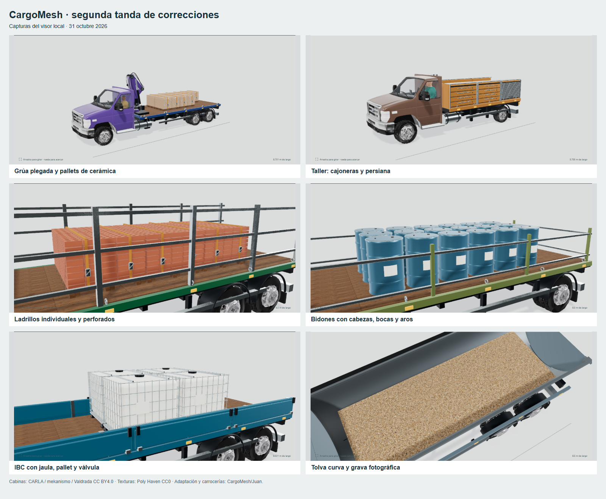

# Juan — segunda tanda de correcciones, v9

31 de octubre de 2026. Petición: corregir también los diez vehículos mostrados por el usuario. Working tree local de `codex/meta-juan`, sobre `3810a589f75e4d4b9c7b7a7f2797cecffc791209`. Sin commit, push, creación/actualización de PR, despliegue o cambios operativos.

[Abrir en localhost](http://localhost:3000/truck-lab#cm-gravel-halfpipe).

## Resultado por vehículo

| Modelo | Cambios |
| --- | --- |
| `cm-mobile-workshop` | Carcasas de servicio, dos cajoneras y una persiana por lado, guías, cerraduras, bancada y tornillo de banco. Los cuatro módulos interiores incorporan cajones y herramientas. |
| `cm-meat-rail` | Puerta lateral, juntas, cantoneras, protecciones interiores, equipo frigorífico bajo la plataforma, evaporador y conducción. Los ocho carros cerrados tienen ruedas, bastidor, puertas y tiradores. |
| `cm-market-awning` | Toldo de superficie ligeramente combada con faldón; soportes y articulaciones unidos al marco. Cajones ventilados con hortalizas visibles. |
| `cm-tile-knuckle` | Grúa plegada, bulones, placas, hidráulicos, mangueras y gancho recogido; espacio reservado detrás de la cabina. Cerámica en paquetes planos apilados sobre los cinco pallets. |
| `cm-brick-cage` | Ladrillos individuales de tamaño menor, ocho capas y perforaciones en la cara superior visible; pallets y flejes. Se evita biselar piezas inferiores ocultas para respetar el presupuesto geométrico. |
| `cm-timber-sideboard` | Tablones separados en capas y columnas, juntas, separadores inferiores y bandas de amarre. |
| `cm-pipe-bolster` | Tubos con pared exterior e interior, cantos de espesor definido, separadores y bandas; se elimina el aro grueso que simulaba cada boca. |
| `cm-drum-rail` | Bidones perfilados, cabezas, rebordes y dos bocas; bastidor de contención lateral y posterior. |
| `cm-ibc-carrier` | Pallet con huecos de entrada, botella redondeada, jaula tubular, travesaños, tapa estriada y válvula protegida dentro de la envolvente. |
| `cm-gravel-halfpipe` | Caja curva con superficies interior/exterior, apoyos adaptados a la curvatura, subchasis, bisagras/cierres, elevación, escalera y rodillo de cubierta. Se retira la plataforma genérica; acabado exterior azul acero, interior metálico y grava con textura fotográfica. |

Las cantidades, medidas y masas declaradas, identidades y conductores siguen siendo fixtures sintéticos. La grúa recibe reserva física en la distribución; el color de la carrocería halfpipe cambia. Los cambios compartidos de mercancía también alcanzan a otros vehículos que la usan. Se mantienen las cinco bases de cabina atribuidas en [su licencia](../../../../cargomesh/public/truck-cabs/LICENSE.md).

## Referencias y material

- [Palfinger PK12002 EH](https://www.palfinger.co.uk/products/product-detail-2/?prodname=PK+12002-EH_S106-SK-D): referencia de grúa articulada, equipos y articulaciones.
- [Carrier Supra](https://www.carrier.com/truck-trailer/en/in/products/in-truck-trailer/truck/supra-series/): opciones de equipos frigoríficos y evaporadores, incluida configuración inferior.
- [SCHÜTZ ECOBULK: componentes del IBC](https://www.schuetz-packaging.net/downloads/datenblaetter-ibc/datenblatt-schuetz-ecobulk-recycling-material-identifier/datasheet-schuetz-ecobulk-recycling-material-identifier-en.pdf): botella, jaula, pallet y válvula.
- [MEILLER MAXTREME](https://www.meiller.com/media/Fahrzeugbau/EN/documents/products/rear-tippers/en_1610_rear_tippers_general_information.pdf): referencia de caja halfpipe y construcción.
- [Sortimo Mobile Working](https://www.mysortimo.com/en/products/mobile-working): organización de taller y módulos.
- [Poly Haven Gravel Floor](https://polyhaven.com/a/gravel_floor), Matterfield / Jenelle van Heerden, **CC0-1.0**: diffuse y normal OpenGL de fotografía, reducidos a512px y aplicados con anchura física de2,3m. [Origen, hashes y derivación](../../../../cargomesh/public/truck-materials/gravel-assets.json). Sin dependencia nueva o servicio de pago.

Estas geometrías son interpretaciones del proyecto; no son CAD ni reproducciones homologadas de esos productos. Se conservan los créditos de las mallas y texturas externas.

## Verificación

- **36/36** pruebas de la colección: catálogo, envolventes, cabinas licenciadas y referencia. Incluyen rayos a través de la entrada de horquilla del IBC, diferencia entre pared interior/exterior del tubo y ausencia de piezas de grúa dentro de los cinco pallets. Tras el último cambio de material/UV: **3/3** regresiones de colocación, contención del árido y separación de la grúa.
- Build de producción final con tipos/lint y `git diff --check`: correctos.
- Navegador: diez casos pedidos y el volquete pequeño que comparte el nuevo material, **11 modelos / 16 detalles**, siete descargas GLB validadas, muestra a390px sin desbordamiento y cero errores JavaScript. [Informe final](browser-final.json).
- Exportación de **60 GLB** finales, 323.701.056 bytes en total. Máximos: 9.761.628 bytes, 174.204 triángulos únicos, **187.955 triángulos instanciados**, 42 primitivas instanciadas y 15 imágenes. No se ampliaron los límites del importador. [Informe](export-verification.json).
- **60/60** archivos finales reimportados en **Blender 5.2.3 LTS**, con dimensiones métricas, geometría finita y cero imágenes externas. [Informe](blender-verification.json).

GLB locales en `C:/Users/PISFIL/Documents/Codex/2026-10-27/re/outputs/truck-realism-v9/models`. La galería permite descargarlos individualmente.

## Vistas

[Comparación de los diez casos](comparacion.png). `before/` y `after/` conservan las capturas individuales. Se usa el mismo visor y ángulo; la cámara automática ajusta el encuadre a los nuevos volúmenes. Los detalles de carga abren el modo de inspección y la vista cenital de grava se obtuvo girando la cámara. La descarga contiene el vehículo completo.

## Límites

Acabado de simulación; no se declara fotorrealismo ni aceptación estética del usuario. Las cabinas y la anatomía proceden de las iteraciones anteriores. Sin medición de FPS o memoria GPU en móviles físicos ni pruebas nuevas de los flujos operativos de Tetris, que no se modificaron.
