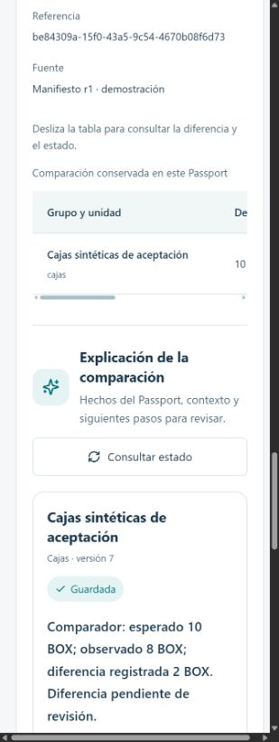

# Evidencia local: explicación guardada en el Passport

1-nov-2026. Autoría Luis/Codex, producto general fuera de Indie. [Aceptación, comandos y límites](../../LUIS_PASSPORT_ACCEPTANCE_2026_11_01.md).

- `verification.json`: resultados registrados, alcance sintético, IDs locales y metadatos permitidos del intento real releídos de PostgreSQL. No contiene credenciales ni el backup privado.
- `saved-passport.jpg`: captura nativa sin retoque, después de recargar y regresar al Passport vigente. Muestra la explicación guardada y los números del comparador en el viewport predeterminado del navegador. No pretende mostrar toda la página.

La captura procede del in-app browser; las capturas anteriores de página completa se descartaron por padding negro del backend de captura. Las medidas responsive del JSON se obtuvieron del DOM, no se dedujeron de ese padding. Verificación visual local realizada por el implementador; no presume aceptación estética de Cristhian.

